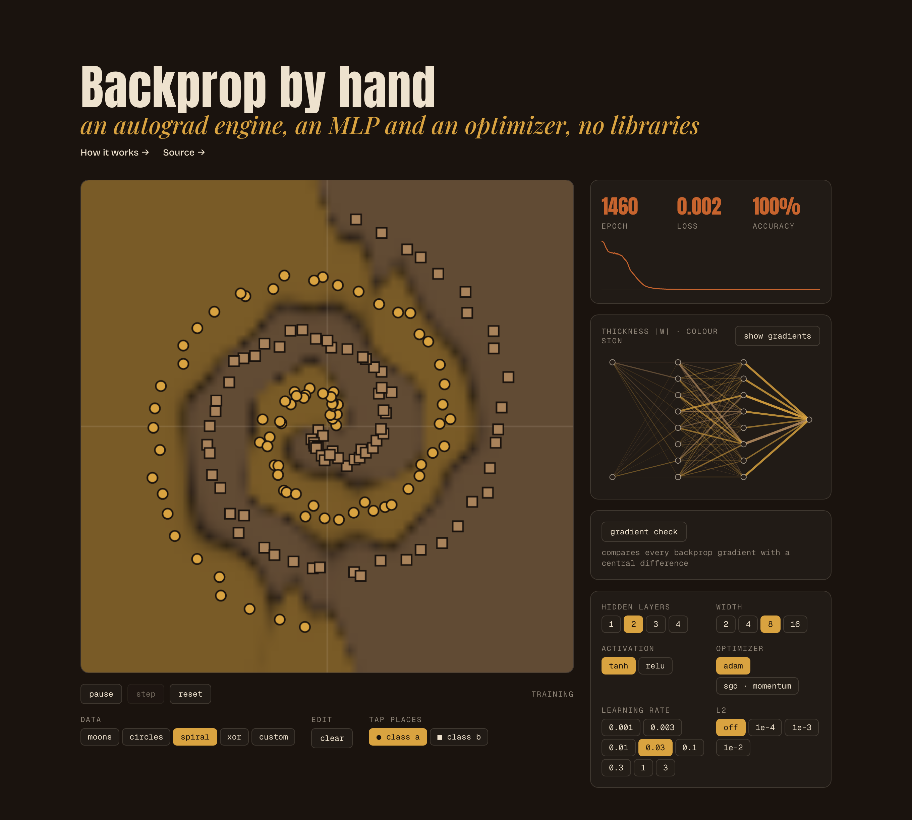
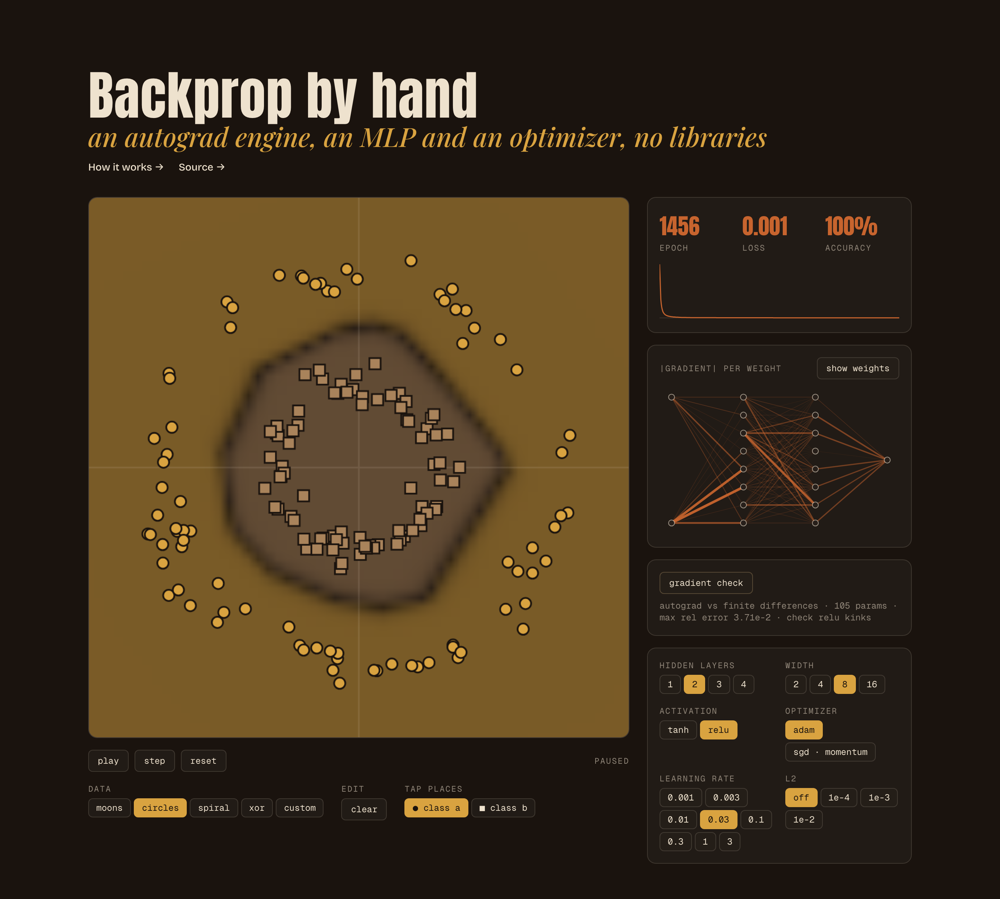

# Backprop by Hand

A reverse mode autograd engine, a multilayer perceptron and SGD or Adam, written from scratch in TypeScript. Place points and watch the decision boundary bend as it trains.





**Live demo:** [worksofabhiram.live/machine-learning-lab/backprop-by-hand](https://worksofabhiram.live/machine-learning-lab/backprop-by-hand)

## What it is

A small interactive lab with no machine learning libraries at all. Everything that makes a neural network learn is written by hand:

- a scalar autograd engine that records a computation graph and walks it backwards,
- a multilayer perceptron with tanh or relu hidden layers,
- binary cross entropy loss with optional L2,
- SGD with momentum and Adam,
- a gradient check that compares every backprop gradient with a finite difference.

The page trains live in the browser. You can pick a dataset (moons, circles, spiral, xor) or draw your own, change depth, width, activation, optimizer, learning rate and L2, and watch the loss curve, the decision boundary and the weights of the network change as it learns.

Controls:

- Click the canvas to place a point of the selected class. Right click or shift click places the other class.
- play, pause and step drive training. reset reinitialises the weights with a new seed.
- show gradients switches the network view from weight magnitude and sign to gradient magnitude.
- gradient check runs a full finite difference check on the current weights.

## How it works

### The computation graph

Every number the network touches is wrapped in a small object: its value, a slot for its gradient, the inputs it came from, and a closure that knows how to push a gradient back to those inputs. Doing arithmetic on these objects builds a graph as a side effect. By the time the loss is computed, the graph records every multiply, add and squash that produced it.

The engine is scalar, like micrograd. One training step over 160 points with a 2 · 8 · 8 · 1 network builds 19,787 nodes, then throws them away. Parameters are the only nodes that live across steps.

### Chain rule, walked backwards

If the loss L depends on a node u, and u feeds into v, then the chain rule says dL/du picks up dL/dv times dv/du. A node used in several places sums the contributions from each use. That sum is why every backward closure does `+=`, never `=`.

```
dL/du = Σ over children v of  (dL/dv) · (dv/du)
```

Reverse mode visits nodes so that every node is finished before its inputs. The engine builds a topological order with an iterative depth first search (no recursion, so a long graph cannot blow the stack), sets dL/dL = 1 on the loss, and calls each closure from the loss back to the leaves. One backward sweep yields the gradient for every parameter at about the cost of one extra forward pass. Forward mode would need one pass per parameter.

### Each op owns its local gradient

An op only needs to know its own derivative. The chain rule does the rest. These are the six ops the whole lab runs on, with out as the result and g as the gradient arriving at out.

```
mul(a, b)     a.grad += b · g        b.grad += a · g
scale(a, k)   a.grad += k · g                       k is a plain number
sum(xs)       x.grad += g  for every x
tanh(a)       a.grad += (1 − out²) · g
relu(a)       a.grad += g  if a > 0, else nothing
softplus(a)   a.grad += sigmoid(a) · g              softplus(a) = log(1 + eᵃ)
```

An n ary `sum` instead of chained binary adds keeps the graph shallow: a neuron with 8 inputs is one sum node, not a chain of 8. Softplus is computed as max(a, 0) + log1p(e^−|a|) so large logits never overflow, and its local gradient uses a sigmoid written to stay stable on both sides of zero.

### The multilayer perceptron

The network maps a point (x, y) to one number, a logit. Each hidden layer computes h = act(W · h_prev + b) with tanh or relu, and the last layer is linear. Weights start Gaussian with variance 1 / fan in for tanh (Xavier) and 2 / fan in for relu (He), so activations neither vanish nor blow up at step zero. Relu biases start at 0.01 so every unit begins alive on some of the data.

The model is plain objects and closures. A layer is a matrix of parameter nodes and a bias vector. The canvas draws the decision boundary with a separate numeric forward pass that reads parameter values directly, so painting a 56 × 56 grid never builds a graph.

### Loss: binary cross entropy, not hinge

With labels y in {0, 1} and logit z, cross entropy on a sigmoid output collapses to one softplus:

```
loss = softplus(z)    if y = 0
loss = softplus(−z)   if y = 1
total = mean over points + λ · Σ w²   (weights only, biases are not penalised)
```

Hinge loss, the micrograd default, gives exactly zero gradient once a point clears the margin, so the boundary stops moving the moment every point is on the right side, often hugging one class. Cross entropy keeps a small pull on every point, which pushes the boundary towards the middle of the gap and gives a smooth, monotone loss curve to watch. It also yields a probability, which is what the shading on the canvas shows. The cost is that the loss never reaches exactly zero, so L2 is there to stop the weights growing forever on separable data.

### Optimizers

Training is full batch: every step uses every point, so one step is one epoch and the curve is not noisy. Two update rules are available.

```
SGD with momentum   v ← 0.9 · v − lr · g          p ← p + v
Adam                m ← 0.9 · m + 0.1 · g
                    s ← 0.999 · s + 0.001 · g²
                    p ← p − lr · m̂ / (√ŝ + 1e−8)   m̂, ŝ bias corrected
```

Adam rescales each parameter by its own gradient history, so one learning rate works across layers whose gradients differ by orders of magnitude. Momentum SGD is simpler and works on the easy sets, but on the spiral the same budget leaves it stuck (see results). Switching optimizer keeps the weights and starts a fresh optimizer state.

### Gradient check

The gradient check button compares every autograd gradient with a central difference computed by an independent numeric loss that never touches the graph:

```
numeric = (L(p + h) − L(p − h)) / 2h                h = 1e−5
error   = |auto − numeric| / max(|auto|, |numeric|, 1e−7)
```

It reports the worst error across all parameters. Below 1e−4 counts as a pass. Relu can fail it honestly when a pre activation sits within h of zero, because the finite difference straddles the kink. The second screenshot above shows exactly that: a relu network trained for over a thousand epochs, where some pre activations sit right at the kink.

### Results

Measured by running this exact code in Node: 160 points per preset (80 per class, fixed seed), network seed 1, full batch, 1,000 epochs. Epochs to 100% is the first epoch where every training point is classified correctly. The default setting is 2 hidden layers of 8, tanh, Adam at 0.03, no L2.

| preset | default · tanh adam | relu adam 0.03 | sgd momentum 0.1 | final accuracy (default) |
| --- | --- | --- | --- | --- |
| moons | 129 | 117 | 269 | 100% |
| circles | 46 | 16 | 109 | 100% |
| spiral | 310 | 320 | never · 53% | 100% |
| xor | 41 | 24 | 96 | 100% |

Gradient check on a 2 · 8 · 8 · 1 network after 50 Adam steps with L2 at 1e−3, all 105 parameters compared: worst error 9.1e−6 with tanh and 2.4e−5 with relu, both on the spiral. On the other three presets it stays between 2.8e−8 and 8.0e−7. One epoch costs about 2 to 3 ms in Node at the default size, which is why the page can run several epochs per frame inside a 10 ms budget.

### Failure modes you can reproduce

| setting | what happens | measured |
| --- | --- | --- |
| relu · sgd · lr 3 · moons | every first layer unit dies | 8/8 dead · loss 0.6931 = ln 2 · 50% |
| relu · adam · lr 1 · moons | half the units die, boundary goes blocky | 4/8 dead · 95% |
| relu · adam · lr 0.3 · spiral | dead units cost the hard set | 3/8 dead · 70% |
| tanh · sgd · lr 30 · moons | overshoots and saturates | loss 7.64 · 51% |
| spiral · 1 layer of 8 | too few bends | 77% after 1,000 epochs |
| spiral · 1 layer of 16 | width can stand in for depth, slowly | 100% at epoch 912 |
| spiral · 3 layers of 8 | depth composes bends | 100% at epoch 275 |
| spiral · L2 1e−2 | penalty beats the fit | 57.5% |

A dead relu outputs zero on every point, so its local gradient is zero and nothing upstream can revive it. A big step is the usual cause: one update shoves the bias far negative. Loss sitting exactly at ln 2 = 0.693 means the network outputs zero for everything, the signature of a fully dead layer.

A huge learning rate with tanh rarely produces NaN, because tanh is bounded. Instead the weights grow, units saturate at ±1, gradients vanish, and the loss stalls high. If the loss ever turns non finite the page stops and asks for a reset.

The spiral needs many bends. Each tanh layer folds the plane once more, so depth buys bends cheaply where a single wide layer has to tile them side by side.

### Limitations

- Scalar nodes are slow. A tensor engine would batch the same math into a handful of array ops and run hundreds of times faster.
- Accuracy is training accuracy. There is no held out set, so 100% here says the net can fit, not that it generalises.
- Full batch only. No minibatches, so no stochastic noise to help escape flat regions.
- Training runs on the main thread in slices of about 10 ms per frame. Fine at this size, not at a larger one.
- Two classes and two input features. No softmax, no feature crosses, no learning rate schedule.
- Results come from one data seed and one network seed. Other seeds move the epoch counts.

## Run locally

Requires Node 20.19 or newer.

```sh
npm install
npm run dev
```

Build and preview the production bundle:

```sh
npm run build
npm run preview
```

## Project structure

```
src/
  autograd/        value node, topological backward sweep, the six ops
  model/           MLP, loss, optimizers, training step, gradient check, seeded rng
  data/            dataset presets (moons, circles, spiral, xor)
  lab/             Lab page, controls, training loop hook
    views/         canvas board, network diagram, scoreboard, loss curve, gradient check
  theme/           colour helpers and a hook that reads CSS colour tokens for the canvas
  theme.css        colour tokens, dark by default, light via prefers-color-scheme
  styles.css       layout and component styles
  App.tsx          page header and lab
docs/screenshots/  README images
```

## License

MIT. See [LICENSE](LICENSE).
